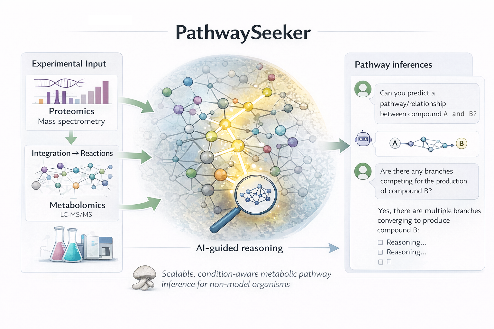

# PathwaySeeker




PathwaySeeker **integrates proteomics and metabolomics data**, map reactions, recover balanced equations, and visualize metabolic networks as interactive graphs.  
Designed to accelerate **multi-omics exploration** in environmental, industrial, or discovery-driven contexts.  

---

## Installation

### 1. Create a virtual environment with Conda
```bash
conda create -n pathseeker python=3.11
conda activate pathseeker
```

### 2. Install dependencies
```bash
pip install -r requirements.txt
```
### 3. (Optional) Register the kernel in Jupyter
```bash
python -m ipykernel install --user --name=pathseeker --display-name "Python (pathseeker)"
```
## Pipeline Execution

The pipeline is modular: each step can be run in the terminal (script mode) or in Jupyter notebooks (exploratory mode).

## 📌 Multiomics graph - Jupyter Notebook
To run in Jupyter notebook:

```bash
jupyter lab
```
If you have Proteomics and Metabolomics data to work: Open ```notebooks/multiomics_graph_proteomics&metabolomics.ipynb``` and run the pipeline step by step.

If you have only Proteomics (or Transcriptomics) data to work: Open ```notebooks/multiomics_graph_only_proteomics.ipynb``` and run the pipeline step by step.


## Outputs

- `matched_metabolites_reactions_all.csv` → final table with reactions and equations  
- `graph_all.html` → interactive graph, viewable in any browser  
- `graph_all.json` → JSON representation of the graph (nodes, edges, attributes), compatible with [PathwayViz](https://tanuki.pnnl.gov/vast35/pathway_viz)  

## Important Notes

Between Step 4 and Step 5, manual curation of the data is recommended before proceeding.

The graph can be visualized either in a web browser or embedded in Jupyter.

## Visualization module 

## AI

## Termodynamic analysis

## Authors

- Lummy M O Monteiro - multiomics graph
- Marjolein T Oostrom - pathway_viz
- Niaz Chowdhury - MDF
- Sutanay Choudhury - AI module

 
DISCLAIMER
This material was prepared as an account of work sponsored by an agency of the
United States Government.  Neither the United States Government nor the United
States Department of Energy, nor Battelle, nor any of their employees, nor any
jurisdiction or organization that has cooperated in the development of these
materials, makes any warranty, express or implied, or assumes any legal
liability or responsibility for the accuracy, completeness, or usefulness or
any information, apparatus, product, software, or process disclosed, or
represents that its use would not infringe privately owned rights.
 
Reference herein to any specific commercial product, process, or service by
trade name, trademark, manufacturer, or otherwise does not necessarily
constitute or imply its endorsement, recommendation, or favoring by the United
States Government or any agency thereof, or Battelle Memorial Institute. The
views and opinions of authors expressed herein do not necessarily state or
reflect those of the United States Government or any agency thereof.
 
                PACIFIC NORTHWEST NATIONAL LABORATORY
                             operated by
                               BATTELLE
                               for the
                  UNITED STATES DEPARTMENT OF ENERGY
                   under Contract DE-AC05-76RL01830
_____________________________________________________________________________________
LICENSE
Copyright Battelle Memorial Institute 2026
 
Redistribution and use in source and binary forms, with or without
modification, are permitted provided that the following conditions are met:
 
1. Redistributions of source code must retain the above copyright notice, this
list of conditions and the following disclaimer.
 
2. Redistributions in binary form must reproduce the above copyright notice,
this list of conditions and the following disclaimer in the documentation
and/or other materials provided with the distribution.
 
THIS SOFTWARE IS PROVIDED BY THE COPYRIGHT HOLDERS AND CONTRIBUTORS "AS IS" AND
ANY EXPRESS OR IMPLIED WARRANTIES, INCLUDING, BUT NOT LIMITED TO, THE IMPLIED
WARRANTIES OF MERCHANTABILITY AND FITNESS FOR A PARTICULAR PURPOSE ARE
DISCLAIMED. IN NO EVENT SHALL THE COPYRIGHT HOLDER OR CONTRIBUTORS BE LIABLE
FOR ANY DIRECT, INDIRECT, INCIDENTAL, SPECIAL, EXEMPLARY, OR CONSEQUENTIAL
DAMAGES (INCLUDING, BUT NOT LIMITED TO, PROCUREMENT OF SUBSTITUTE GOODS OR
SERVICES; LOSS OF USE, DATA, OR PROFITS; OR BUSINESS INTERRUPTION) HOWEVER
CAUSED AND ON ANY THEORY OF LIABILITY, WHETHER IN CONTRACT, STRICT LIABILITY,
OR TORT (INCLUDING NEGLIGENCE OR OTHERWISE) ARISING IN ANY WAY OUT OF THE USE
OF THIS SOFTWARE, EVEN IF ADVISED OF THE POSSIBILITY OF SUCH DAMAGE.
